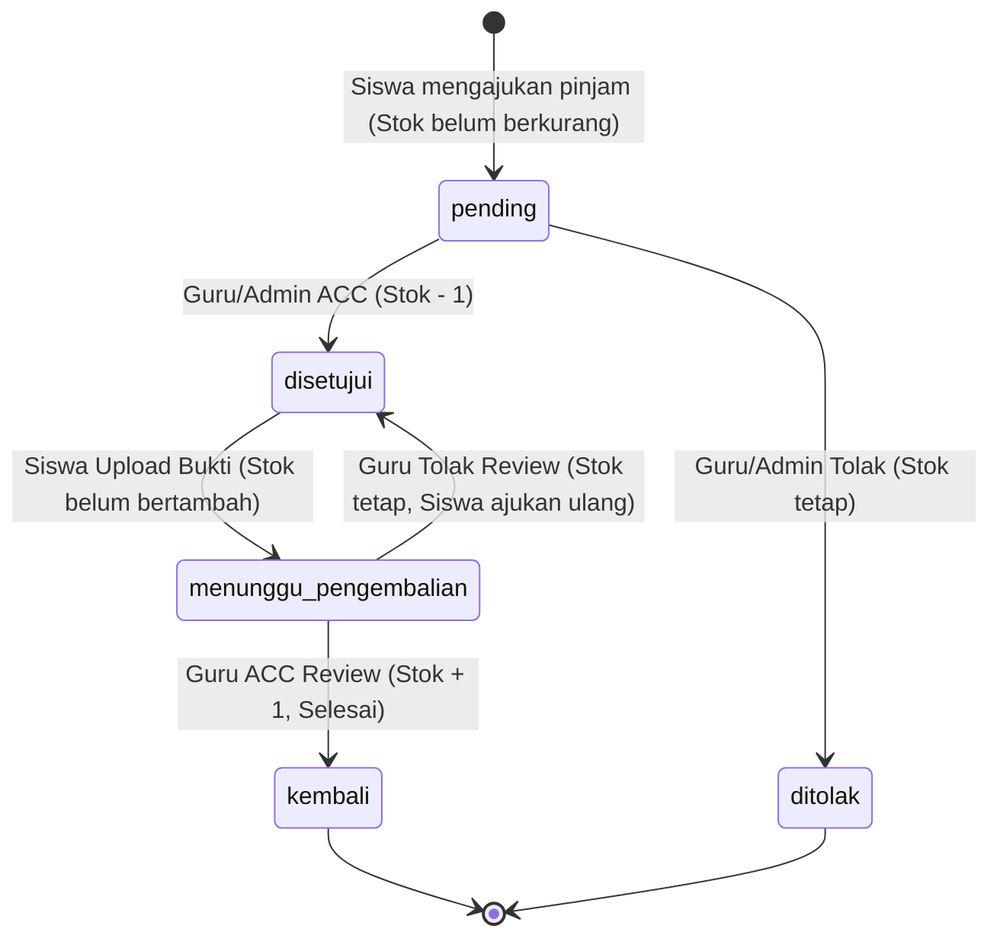

# Ringkasan Logika & Semantik Stok Peminjaman (Berdasarkan PHP Asli)

Dokumen ini membedah alur logika asli dari berkas-berkas PHP legacy (`proses_pinjam.php`, `tambah.php`, `acc.php`, `tolak.php`, `kembali.php`, `proses_ajukan_kembali.php`, `proses_review_kembali.php`, dan `api/peminjaman.php`) untuk memastikan semantik mutasi stok dan alur status diimplementasikan secara persis tanpa merancang ulang.

---

## 1. Kapan Stok Berkurang dan Bertambah?

Berdasarkan kode PHP asli:
1. **Saat Pengajuan Peminjaman (`pending`):**
   - Siswa memilih alat yang memiliki `stok > 0`.
   - **Stok TIDAK berkurang** di tabel `barang` saat status masih `pending`.
   - Catatan: Stok hanya diverifikasi ketersediaannya (`stok > 0`).

2. **Saat Persetujuan Peminjaman oleh Guru/Admin (`acc.php` / `action=acc`):**
   - Guru/Admin memeriksa pinjaman berstatus `pending`.
   - **Stok DIKURANGI 1** (`UPDATE barang SET stok = stok - 1 WHERE id = ?`).
   - Status peminjaman berubah menjadi `disetujui`.

3. **Saat Penolakan Peminjaman oleh Guru/Admin (`tolak.php` / `action=tolak`):**
   - Status berubah dari `pending` menjadi `ditolak`.
   - **Stok TIDAK berubah** (karena stok belum pernah dikurangi).

4. **Saat Siswa Mengajukan Pengembalian (`proses_ajukan_kembali.php`):**
   - Siswa mengunggah foto bukti pengembalian fisik dan catatan kondisi alat.
   - Status berubah dari `disetujui` menjadi `menunggu_pengembalian`.
   - **Stok TIDAK bertambah** saat pengajuan ini karena alat belum diverifikasi fisiknya oleh guru.

5. **Saat Guru/Admin Menyetujui Pengembalian (`proses_review_kembali.php` -> `acc_kembali`):**
   - Guru memverifikasi fisik alat dan bukti foto.
   - **Stok DITAMBAH 1** (`UPDATE barang SET stok = stok + 1 WHERE id = ?`).
   - Status peminjaman berubah menjadi `kembali` dan tanggal pengembalian dicatat (`tgl_kembali = CURDATE()`).

6. **Saat Guru/Admin Menolak Pengembalian (`proses_review_kembali.php` -> `tolak_kembali`):**
   - Guru menolak karena bukti tidak jelas atau fisik alat belum dikembalikan ke rak bengkel.
   - Status dikembalikan dari `menunggu_pengembalian` ke `disetujui` disertai catatan alasan penolakan (`catatan_penolakan`).
   - **Stok TIDAK bertambah** dan siswa wajib mengajukan ulang pengembalian.

---

## 2. Struktur Data: Apakah Ada `jumlah` atau `detail_peminjaman`?

- Pada tabel utama `peminjaman`, terdapat relasi langsung: `id_barang` (FOREIGN KEY ke `barang.id`).
- Pada alur katalog UI modal (`openModalPinjam`) dan `api/peminjaman.php`, setiap peminjaman meminjam 1 unit alat (`jumlah = 1`).
- Skema juga memiliki tabel pendukung `detail_peminjaman (id_peminjaman, id_barang, jumlah)`. Untuk menjamin integritas 100% relasional, setiap pengajuan mencatat header di `peminjaman` dan baris relasi di `detail_peminjaman` dengan `jumlah = 1`.

---

## 3. Aturan Siswa Meminjam Barang yang Sama

- Di versi PHP asli (`api/peminjaman.php`), pengecekan hanya memvalidasi apakah stok alat masih tersedia (`stok > 0`). Siswa diizinkan meminjam barang yang sama jika stok mencukupi.
- Namun untuk mencegah penyalahgunaan spam, jika siswa memiliki pinjaman berstatus `pending` atau `disetujui` untuk barang yang sama yang belum selesai dikembalikan, sistem memberikan notifikasi yang jelas bahwa alat tersebut sedang dalam status aktif dipinjam olehnya.

---

## 4. State Machine Transisi Status (Ketat)

Aturan Eksekusi SQL State Machine:
- Setiap pembaruan status **WAJIB** menggunakan klausul kondisi status asal:
  `UPDATE peminjaman SET status = ? WHERE id = ? AND status = ?`
- Periksa `affectedRows === 1`. Jika 0, maka request ditolak (mencegah *race condition*, lompat status, atau replay attack).
- Operasi mutasi stok **WAJIB** menggunakan transaksi MySQL terisolasi dengan kunci baris (`FOR UPDATE`) dan kondisi `stok >= 1`.
